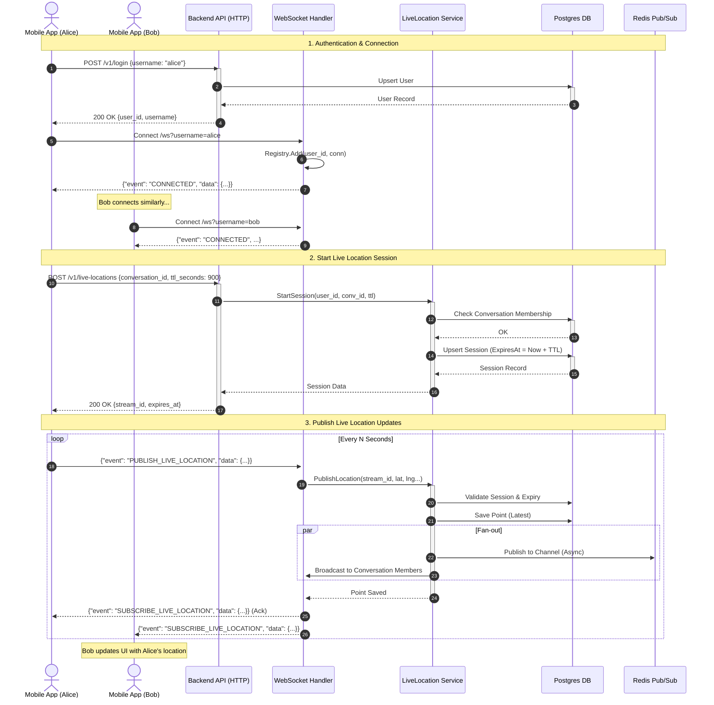

# End-to-End User Journey: Login to Live Location Sharing

The following sequence diagram illustrates the flow from a user logging in, connecting to the WebSocket, initializing a live location session, and broadcasting location updates to other users in a conversation.

