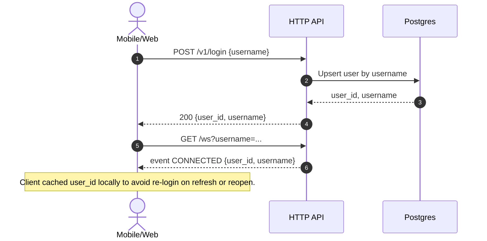
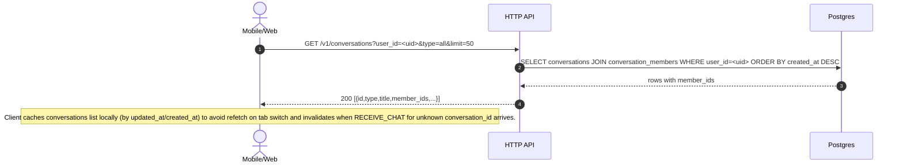
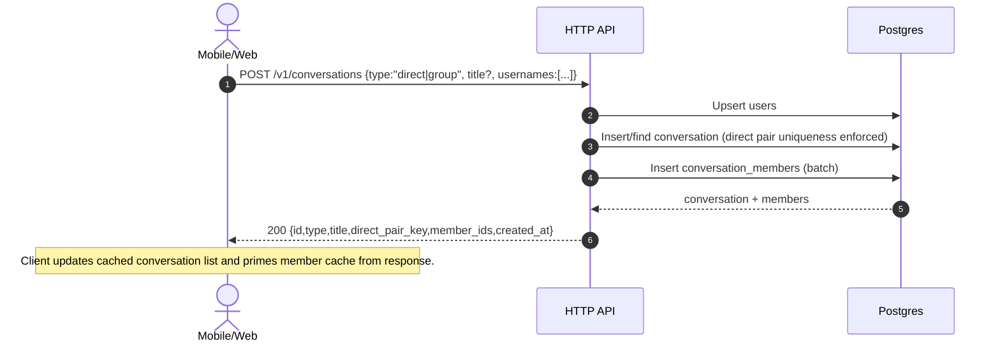
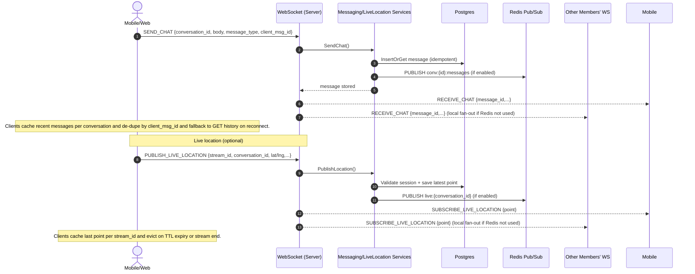

# End-to-End Sequences

- Status: Approved
- Owner: Backend Team
- Last updated: 23/01/2026

Sequence diagrams for the main app screens: login, conversation list, creating a new chat, and chatting with messages + live location.

## Login Screen

## Conversation Screen (List)

## Create New Chat (from Conversation Screen)

## Chat Detail Screen (Send Chat + Live Location)

